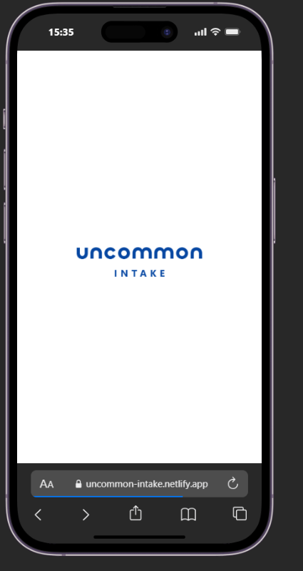
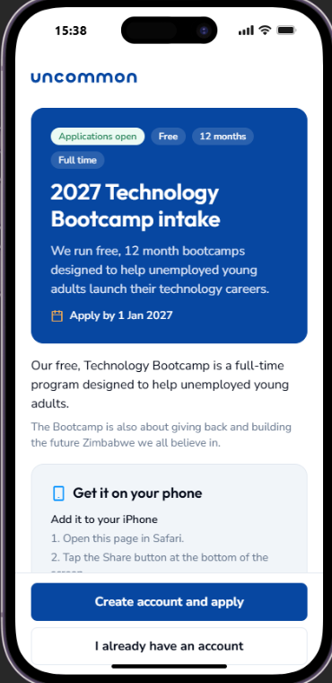
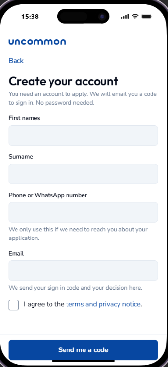
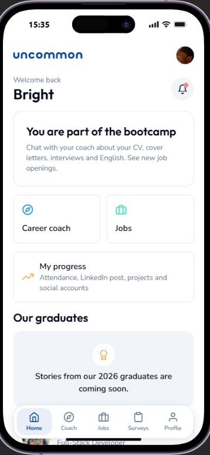
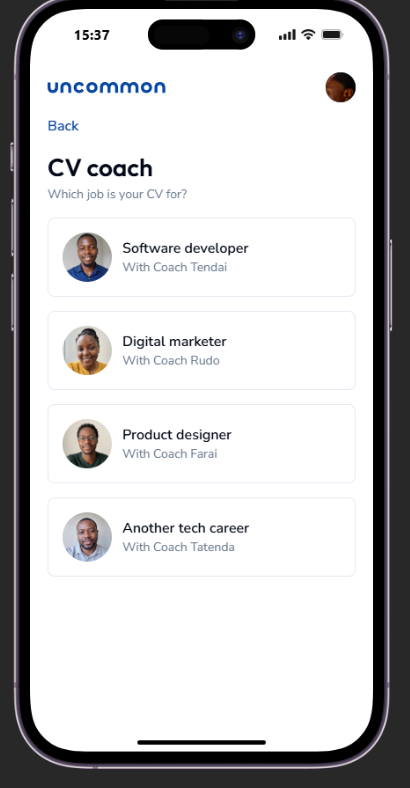
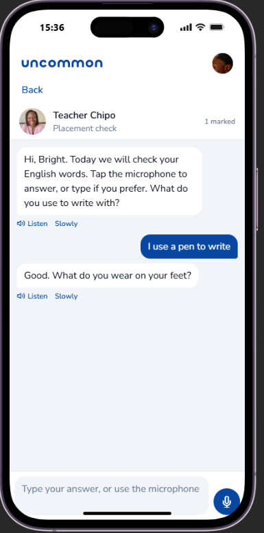
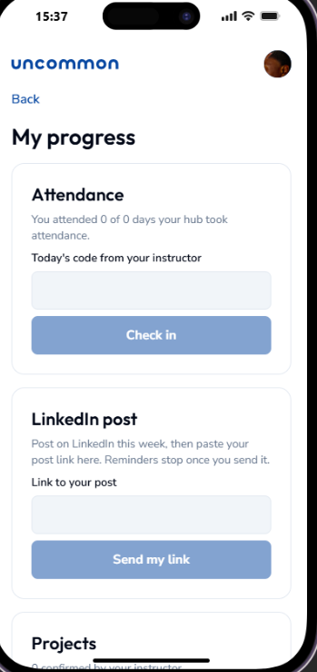
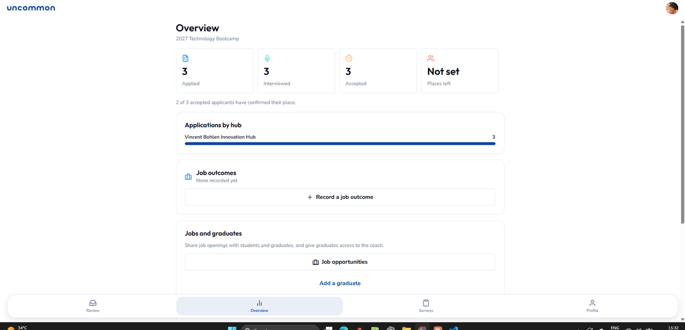

# Uncommon Intake

One system for [Uncommon.org](https://uncommon.org)'s free, 12 month Technology Bootcamp in Zimbabwe:
people apply on their phone, staff review them and decide, and accepted students get support during
the bootcamp and after they graduate.

It works as an **Android app** and a **website** (laptops and phones). iPhone users add the website to
their home screen. Solo capstone project.

- **Website:** https://uncommon-intake.netlify.app
- **Android app:** tap "Download for Android" on the website

## Screenshots

| Splash | Website home | Create an account | Student home |
| --- | --- | --- | --- |
|  |  |  |  |

| CV coach | English Tutor | My progress |
| --- | --- | --- |
|  |  |  |

**Staff overview on a laptop**



## The problem

Applying to the bootcamp, reviewing hundreds of applicants across 13 Innovation Hubs, and supporting
students once they join all happened in different places. Most applicants use a phone, often on
expensive or slow mobile data. Uncommon Intake puts all of it in one place that works on a cheap phone.

## What it does

### Applicants
- Create an account with name, phone or WhatsApp and email. Sign in with a code sent by email, no passwords.
- Apply in 2 steps with autosave and a review screen:
  1. Details: name, phone, where they live, and the Innovation Hub they want.
  2. A CV (or a short "about you" if they have no CV) and a motivation letter, as PDF or Word.
- AI checks that each file is the right kind of document and kindly asks for the right one if not.
  Files it cannot read are still accepted, so nobody is stopped by a technical problem.
- AI writes 10 personal interview questions from the CV and the letter. They never ask about age,
  gender, family, religion, tribe, health, money or politics.
- Answer each question by typing, voice or short video. Answers are saved on the phone and upload
  when the network allows. Low data mode.
- Follow the application status. The decision arrives in the app, by notification and by email.
  Accepted applicants confirm their place.

### Students and graduates
- **Career coach** chat for CVs, cover letters and job interview practice, with a named coach per career.
- **English Tutor** with a placement check, real life lessons, voice answers and Listen (read aloud).
- **Job opportunities**, shared by staff with everyone.
- **My progress**: attendance check in with a daily code, a weekly LinkedIn post reminder, projects and social accounts.
- A weekly update built only from the student's real numbers.
- Profile with photo and a short bio. Anyone can delete their own account and data.

### Staff, hub leads and admins
- Staff sign up at `/staff` with an @uncommon.org email and choose a hub. Their hub lead or an admin approves them.
- Each person only sees applicants and students from their own hub. Admins see every hub.
- Review board with search and filters. Each applicant has Interview, Application and Notes tabs:
  answers, video and audio, transcripts, AI summaries, CV, motivation letter and notes.
- Accept, Waitlist or Decline. Someone on the waiting list can still be accepted or declined later.
  Every decision is logged.
- Overview counted only from real data: applied, interviewed, accepted, places left, applications by hub.
- Surveys with AI themes (each theme links back to the real answers), messages to students,
  job opportunities, job outcomes and graduate stories (shown only with written consent).
- Delete applicant and student accounts, surveys, jobs, outcomes and stories.

## How AI is used

AI helps people. It never decides anything about a person: staff make every decision.

| Feature | What the AI does | Model |
| --- | --- | --- |
| Uploaded files | Checks a CV is a CV and a letter is a letter | `gpt-6-luna` |
| Interview questions | Writes 10 questions from the CV and letter | `gpt-6-luna` |
| Interview answers | Speech to text, then a short summary for staff | `gpt-transcribe`, `gpt-6-luna` |
| Surveys | Finds common themes, each linked to the original answers | `gpt-6-luna` |
| Career coach, English Tutor | Coaching, teaching and marking single answers | `gpt-6-luna` |
| Listen | Reads a message aloud | `gpt-4o-mini-tts` |

All AI runs on the server in Supabase Edge Functions (`supabase/functions/_shared/ai.ts`). The app
never holds an AI key. One setting (`AI_PROVIDER`) can switch to a Hugging Face fallback.

## How it is built

| Part | Technology |
| --- | --- |
| App and website | React Native with Expo (SDK 57), TypeScript, Expo Router |
| Database, login, files | Supabase: PostgreSQL with Row Level Security, email codes, private storage |
| Server code | Supabase Edge Functions (Deno) |
| Scheduled jobs | pg_cron: LinkedIn reminders, weekly updates, clean up of old recordings |
| AI | OpenAI, called only from Edge Functions |
| Website hosting | Netlify |
| Android builds and updates | Expo EAS Build and EAS Update |

```
Phone or browser  ->  Supabase (login, database rules, files)
                  ->  Edge Functions  ->  OpenAI
```

## Security and privacy

- Row Level Security on every table: people only get the rows they are allowed to see.
- CVs, letters, recordings and photos are in private storage, opened with links that expire.
- Interview recordings are deleted after about 90 days. Transcripts and summaries stay for staff.
- Secrets (AI key, email password) live only in Supabase. The app holds only the public Supabase URL and key.
- The website sends security headers, ships no source maps, and asks AI crawlers not to read it.
- The privacy notice follows Zimbabwe's Cyber and Data Protection Act.

## Project structure

```
src/
  app/            Screens (Expo Router)
    (public)/     Website home, sign up, sign in, staff sign up
    (app)/        Applicants, students and graduates
    (staff)/      Staff, hub leads and admins
  components/     Shared UI: buttons, cards, uploads, recorders, tab bar
  lib/            Supabase client, login, data loading, upload queue, notifications
  theme.ts        Colours, fonts and spacing (brand blue #0747A1)
  content.ts      Bootcamp wording
supabase/
  migrations/     Database tables, access rules, storage and scheduled jobs
  functions/      Edge Functions (all AI and server work)
  setup/          SQL templates for setting up a real intake
public/           Website files: icons, page template, headers, robots.txt
scripts/          Development only test accounts and build helpers
docs/screenshots/ Images used in this README
assets/           App icon, splash screen and coach pictures
```

## Run it yourself

```bash
npm install
cp .env.example .env     # add your own public Supabase URL and anon key
npx expo start           # open on a phone with a development build, or press w for the website
```

Database and server code:

```bash
npx supabase link --project-ref <your-project-ref>
npx supabase db push
npx supabase functions deploy --use-api
```

Set the server secrets in the Supabase dashboard (Edge Functions, Secrets). The names are in
`supabase/functions/.env.example`. Never commit real values.

Builds:

```bash
npx eas-cli build --platform android --profile preview     # Android APK
npx eas-cli update --channel preview --environment preview # update installed apps
npx expo export -p web                                      # website files for Netlify
```

## Rules the project follows

1. **No fake data.** Empty means an honest empty state, never invented people or numbers.
2. **People decide, AI helps.** Every AI result is labelled.
3. **No secrets in the app.**
4. **Simple English** that works for first time applicants.
5. **Works on low data** and on cheap phones.

## License

MIT. See [LICENSE](LICENSE).
